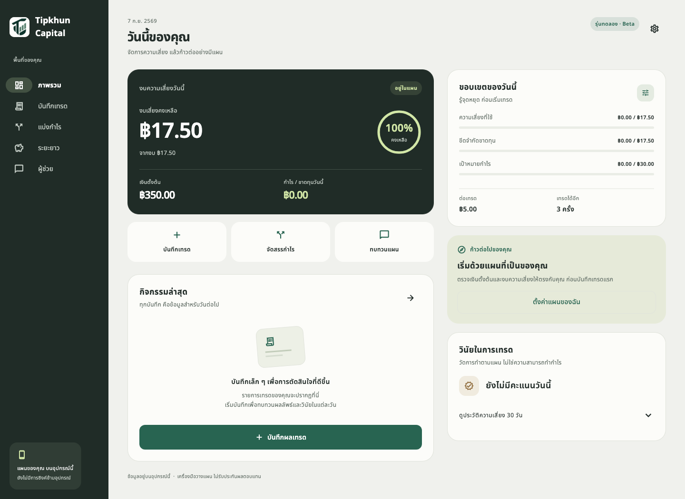
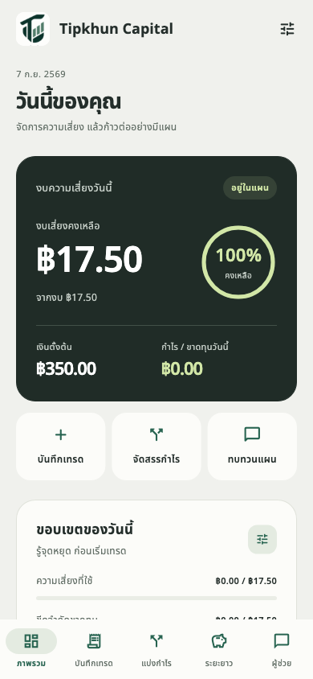
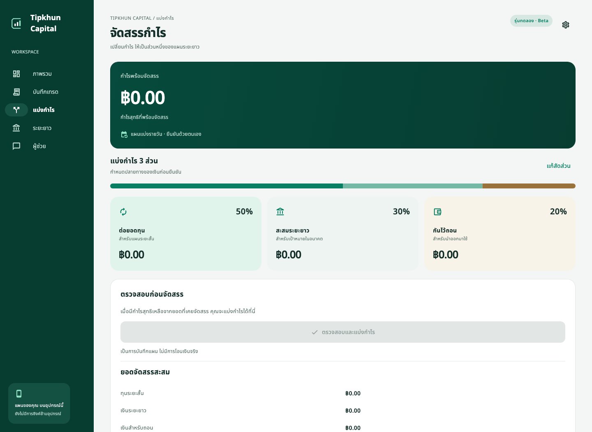
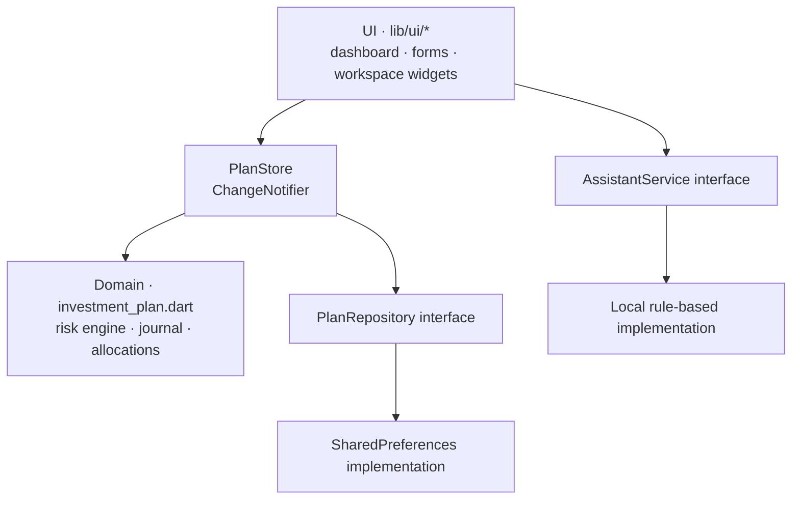

<p align="center">
  
</p>

<h1 align="center">Tipkhun Capital</h1>

<p align="center">
  <b>A Flutter app that helps retail traders stick to a risk plan:<br>
  daily loss budget, trade journal, discipline score and profit allocation.</b>
</p>

<p align="center">
  
  
  
  
</p>

<p align="center">
  
  &nbsp;
  
</p>

## The problem

Most small traders don't lose money because of one bad trade. They lose it by **not stopping**: chasing losses after the daily limit, or giving back a day's profit. Tipkhun Capital turns a risk plan into hard numbers the user sees before every trade:

1. **Plan:** starting capital, daily risk %, risk per trade, max trades, profit target.
2. **Trade and journal:** record each result with fees. The remaining budget updates instantly.
3. **Stop:** the app latches a STOP state when the loss limit, risk budget, trade count or target is hit.
4. **Allocate profit:** split net profit into reinvest / long-term / withdraw buckets so gains aren't all put back at risk.

## Features

| Page | What it does |
|---|---|
| **Overview** | Remaining daily risk budget with a live gauge, loss-limit and target progress, quick actions, next steps |
| **Trade journal** | Record asset, gross P/L, fees, time, strategy and notes. Filter by today / 7 / 30 days / all |
| **Profit router** | Editable allocation ratios (must total 100%), preview before confirming, full allocation history |
| **Long term** | Running totals per bucket, 30-day risk history, discipline score |
| **Assistant** | Answers questions about *your* plan from local data, behind a replaceable provider interface |

Thai-first UI with bundled Noto Sans Thai, responsive from 320px phones to desktop, with loading, error and empty states throughout.

<p align="center"></p>

## Engineering decisions

- **Money as integers.** All amounts are stored in *satang* (1/100 baht) and percentages in basis points, so there's no floating-point drift in budgets or allocations. Rounding remainders are assigned deterministically and no satang is ever lost.
- **Pure domain layer.** The risk engine (`lib/domain/investment_plan.dart`) is plain Dart with no Flutter imports, which makes it fast to unit-test and reusable on a server later.
- **Persistence you can trust.** `PlanStore` publishes a change to the UI **only after it is saved**. A failed save never shows data that isn't stored, and corrupt storage is reported instead of being silently overwritten.
- **Correct under edge cases.** Backdated trades are replayed in time order. Winning trades never refill the day's risk budget. Reaching the target latches STOP for that day, and real losses beyond the plan can still be recorded, but they're flagged as discipline violations.
- **Repository and service interfaces.** Storage (`PlanRepository`) and the assistant (`AssistantService`) are interfaces, so cloud sync or a real LLM can be swapped in without touching the UI.

### Architecture



## Tests

16 automated tests across three suites:

| Suite | Covers |
|---|---|
| `risk_engine_test.dart` | Losses consume budget, wins never restore it; stop latching; satang-exact allocation; invalid input rejected |
| `persistence_test.dart` | Save/reload round-trip, failed saves, corrupt storage, fees, backdating, allocation rounding |
| `widget_test.dart` | Real user flows (record a loss, allocate profit); every page fits 320px, 390px and desktop; large-text accessibility |

```bash
flutter analyze
flutter test
```

## Run it

```bash
git clone https://github.com/tawan230666/SuperApp.git
cd SuperApp
flutter pub get
flutter run -d chrome        # or: flutter devices && flutter run
```

Regenerate the preview screenshots and app icons with `flutter test tool/render_brand_test.dart`.

<details>
<summary><b>Calculation policy (full rules)</b></summary>

- Daily risk used = the sum of negative **net** trade outcomes. Winning trades never refill the budget.
- Loss-limit or risk-budget exhaustion takes precedence over the profit target. Reaching the target latches STOP for that local day, even if a later trade loses.
- The maximum trade count, or a remaining budget smaller than the per-trade risk, also stops the plan.
- The daily view resets at local midnight; records and allocations persist.
- Profit available to allocate = lifetime net P/L − profit already allocated, floored at zero. This prevents allocating the same profit twice or ignoring later losses.
- **Discipline score** = trades without a violation ÷ trades that day × 100. A violation is a trade after a stop condition, or a loss larger than the per-trade risk allowance. It measures plan compliance, not trading skill.
</details>

## Scope and limitations

This is a **planning and journaling tool**. It does not connect to brokers, move money, or give investment advice.

- Data is stored on the device only (no cloud sync yet). Clearing app data removes it.
- The assistant uses local rules, not a hosted AI model. Long-term AI analysis is marked *Coming soon* rather than faked.
- The risk plan locks after the first recorded trade, so historical risk calculations stay consistent (allocation ratios remain editable).

## Roadmap

- Encrypted cloud backup and multi-device sync
- Plan versioning, so the risk plan can change over time while keeping history
- LLM-backed assistant behind the existing `AssistantService` interface

Product research and MVP planning documents (Thai) are in [`docs/`](docs).

---

**Author:** Tawan Tiphkun ([@tawan230666](https://github.com/tawan230666)), Software Engineering, RMUTL Chiang Mai
